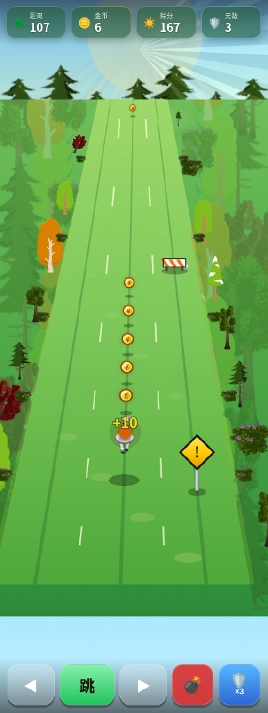
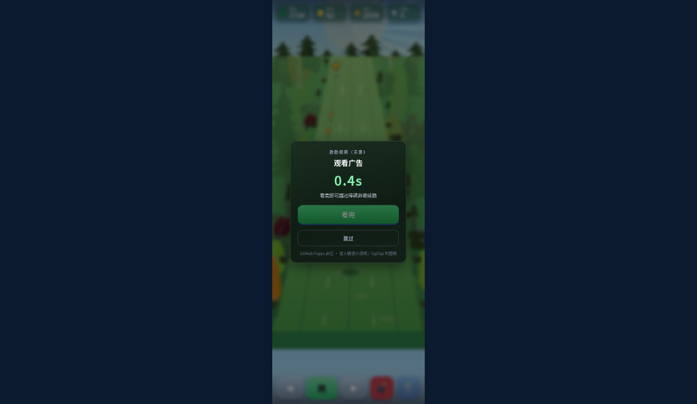

# 测评汇总 · 2026-10-25（Asia/Shanghai）

> **性质：实测（权威）** + 早间预判留档对照。  
> **实测**：computerUse · desktop Chrome ~420px 列 · 硬刷 [?v=adsense1](https://liangchaoboy.github.io/running_bull/mobile-web/?v=adsense1)。  
> 截图：[`docs/playtest-2026-10-25/`](playtest-2026-10-25/)（摘自 `/workspace/playtest/01…13`）。  
> 量表原文：[`PLAYABILITY_EVAL.md`](PLAYABILITY_EVAL.md) · [`DEPTH_FEEL_SCORECARD.md`](DEPTH_FEEL_SCORECARD.md)

## 构建

| 端 | 链接 / 标识 |
|----|-------------|
| mobile-web | https://liangchaoboy.github.io/running_bull/mobile-web/?v=adsense1 · 测评时 HEAD 含 `966085d`（forest / hero3d / reward / adsense） |
| XBuilder | https://x.qiniu.com/project/wechat-f860f2cd2d58bcf7/running_bull（同链已 Publish） |

---

## 实测结论（本轮权威）

### 可玩性 A–H → **31 / 40**

| A操作 | B公平 | C前8s | D死亡 | E擦边 | F爬坡 | G分数 | H分享 | **总分** |
|------|------|------|------|------|------|------|------|---------|
| **4** | **4** | **4** | **4** | **4** | **4** | **4** | **3** | **31 / 40** |

| 门槛 | 结果 |
|------|------|
| **硬门槛** A/B/D ≥4 | **过**（4 / 4 / 4） |
| **软门槛** ≥28/40 且 C/E/F ≥3 | **过**（31；C/E/F 均 4） |
| 传播加分 H≥4 | **未达**（H=3 → 可演示，暂不投流） |

**备注（实测）：**
- **E=4**：来自金币 / `+10` 飘字 / 清道 toast 等可见反馈；**没有**独立「擦边勇敢」电报线（`braveStacks` 仍未接线）。按检查表「3 局内可见反馈」过关，但与 [`GAME_DESIGN.md`](GAME_DESIGN.md) 擦边倍率设计仍有差距。
- **D=4**：撞障 → 激励假片暂停可读；文案**未**明说「撞到了」；约 **2s** 自动可看完。本局路径几乎不进 `#over`（见 H）。
- **H=3**：撞障走 rewarded 续跑，**弱再玩节拍**；playtest 中 **`#over` 结算卡未出现** → 截结算发群动机弱。

### 前冲立体感 · 优美森林 → **25 / 30**

| 1灭点 | 2缩放 | 3速差 | 4冲镜 | 5地面 | 6角色 | **总分** |
|------|------|------|------|------|------|---------|
| **5** | **4** | **4** | **4** | **4** | **4** | **25 / 30** |

| 门槛 | 结果 |
|------|------|
| ≥24 且无单项 ≤2 | **过（实测）** |

- #6 **实测 4**（锁旋转成立；早间预判曾估 5，实机定 4）。  
- **悬空**：短暂跑过，体感约 **20–22/30**，画面干净无炸。  
- 换道叠帧参考：[`04-lane-right-180ms.png`](playtest-2026-10-25/04-lane-right-180ms.png)

---

## 下轮优先级（按实测修订）

1. **H · 再玩 / 结算节拍** — 在激励续跑之外恢复可感知的「一局结束」：可选手动认输 / 体力耗尽 / N 次假片后进 `#over`；结算卡要稳定能出，才谈挑战卡与 H≥4。  
2. **可选：真擦边电报** — 仍建议接 `braveStacks` +「勇敢 +1」飘字（设计核心差异）；非软门槛阻塞，但是评委故事线。  
3. **D 文案 + AdSense** — 假片标题明示「撞到了 / 看完越过」；真展示广告仍等 `ca-pub`（不阻塞手感分）。

~~原预判 Top1「必须接线才过软门槛」已由实测 E=4（广义反馈）推翻；软门槛已过。~~

---

## 早间预判（留档对照 · 已 superseded）

| | 可玩性 | 深度森林 | 硬门槛 | 软门槛 |
|--|--------|----------|--------|--------|
| **预判**（代码走查） | 26/40（E=2） | 25/30（#6=5 估） | 过 | **不过** |
| **实测**（本轮） | **31/40**（E=4） | **25/30**（#6=4） | **过** | **过** |

预判偏差主因：把 E 绑死在 `braveStacks`；实机用金币/`+10`/清道反馈达到检查表 E≥3。深度总分碰巧同为 25，但 #1 实测 5、#6 实测 4（预判相反方向微调）。

---

## 文档索引

| 文档 | 变更 |
|------|------|
| 本页 | 实测权威 + 预判对照 |
| [`PLAYABILITY_EVAL.md`](PLAYABILITY_EVAL.md) §7–8 | §7 预判保留；§8 追加实测 31/40 |
| [`DEPTH_FEEL_SCORECARD.md`](DEPTH_FEEL_SCORECARD.md) | 追加实测 25/30 |
| [`playtest-2026-10-25/`](playtest-2026-10-25/) | 3 张代表帧 |

Pages：https://liangchaoboy.github.io/running_bull/mobile-web/?v=adsense1  
本文件：https://github.com/liangchaoboy/running_bull/blob/main/docs/EVAL_2026-10-25.md
